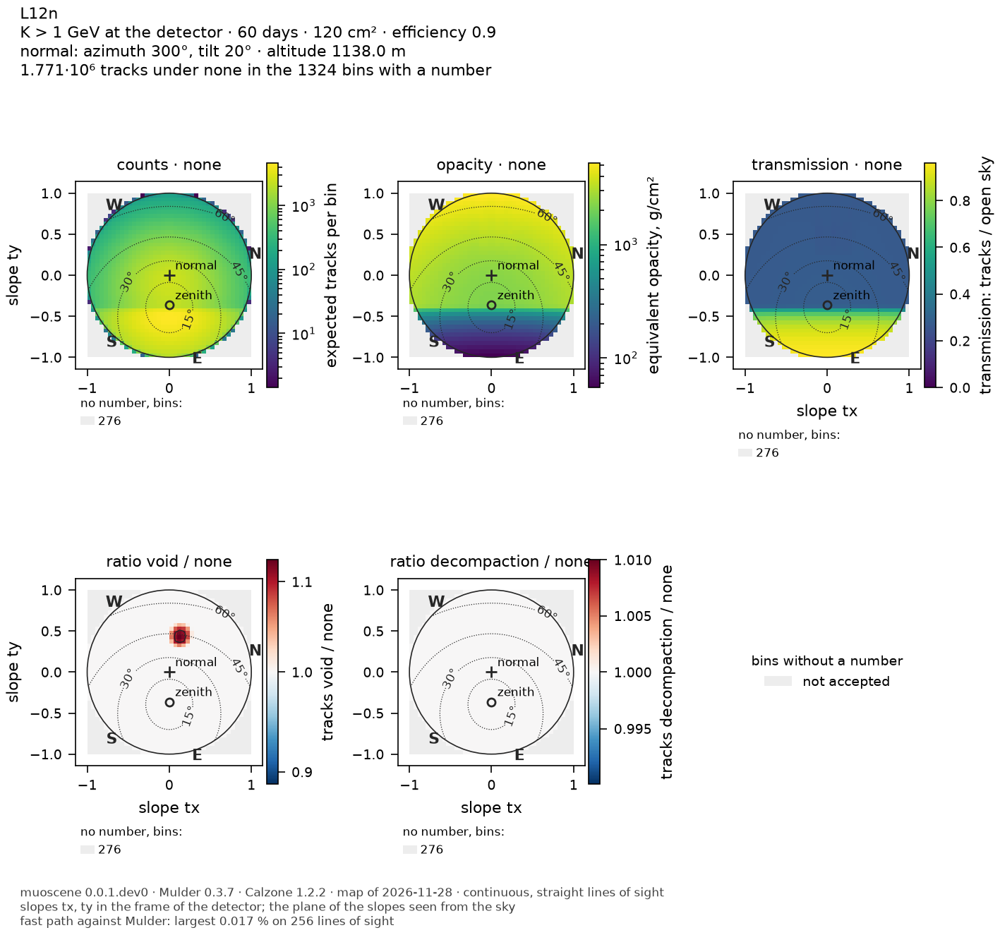

# Figures

Roadmap task 0.1-12a, 28 November 2026, matplotlib 3.11. Modules `muoscene.viz.maps`, `muoscene.viz.curves` and `muoscene.viz.style` (layer 5); conventions, revision 5, sections "Detector pose", "Direction grid" and "Expected map". Every number below comes from the named test of `tests/unit/test_viz_maps.py`, `test_viz_curves.py` or `test_example_*.py`, or from the command next to it.

## What is there

| Figure | Function | What it shows |
|---|---|---|
| one quantity of a map | `maps.map_figure(expected, detector, quantity, hypothesis)` | `counts`, `opacity` or `transmission` of one detector under one hypothesis |
| ratio of two hypotheses | `maps.ratio_figure(expected, detector, hypothesis, reference)` | the counts under one hypothesis over those under another, bin by bin |
| sheet of a detector | `maps.sheet_figure(expected, detector, panels)` | counts, opacity, transmission and the ratios on one page: what a run gives for one detector |
| any array on the grid | `maps.array_figure(values, grid, mask=, status=, pose=, tan_max=)` | binned tracks (0.1-15), a ratio of data to model (0.1-16), anything per bin |
| an array on an Axes of one's own | `maps.draw_map(ax, values, grid, ...)` | the same, for a figure composed by hand |
| flux of a table | `curves.flux_figure(table, responses, opacity_g_cm2=, others=)` | integral flux above each threshold against the zenith angle, and where the table has no number |
| the numbers of that curve | `curves.flux_curve(table, response, zenith_deg, opacity_g_cm2)` | a `FluxCurve`: the flux, masked where the table has no number, the reason, the angle where it ends |
| writing a file | `style.save(figure, path)` | PNG at 200 dpi, PDF, SVG, by the suffix |

Every function returns a `matplotlib.figure.Figure` attached to no window: nothing is shown on a screen, and the figures are made the same way on Windows, macOS and Linux and in CI. Importing `muoscene.viz` does not import matplotlib (`test_importing_the_figures_does_not_import_matplotlib`).

## Decisions of 28 November 2026

| Question | Decided | Alternatives and their price |
|---|---|---|
| Axes of a map | the slopes tx, ty of the detector, bins as they are, one unit of slope the same length on both axes | zenith and azimuth: bins of the grid become curved cells, and binned tracks of a scan, whose axes are those of the film, would need a transform before every comparison |
| From which side the plane of the slopes is seen | from the sky, against the normal: tx grows to the right, ty upwards; for a detector with its three angles at zero east is to the right and north up, as on a plan (decided on 28 November 2026). The conventions are not changed: the rule lives here and in the docstring of `viz.maps` | from the detector, as it sees the sky, with ty downwards: the zenith of a tilted detector above its normal, but a horizontal film is the mirror of a plan and ty runs against the histograms of the scanning group |
| Where the detector looks | dotted lines of equal zenith angle every 15° with their values, inside the acceptance circle; the horizon as a thick line; the zenith (a circle) and the normal (a cross, at 0, 0); N, E, S, W where the lines of sight towards those azimuths leave the acceptance circle or reach the horizon inside it | a compass rose in a corner: it shows the axes of the detector, not where its lines of sight go; for a tilted detector the two differ |
| Bins without a number | a grey and a hatch for every reason — not accepted, below the cut-off, elevation outside the table, opacity beyond the table, open sky without a number (for the transmission), masked by the caller, nothing below in a ratio — and a line in the legend with the number of bins; a nan where a number is expected is refused | the colour of zero or an empty place: a missing number would read as no muons |
| Scales | viridis; logarithmic when every value is positive and the largest is at least 30 times the smallest, linear from zero otherwise; limits can be fixed so that data and model share one scale. Ratios: RdBu_r, symmetric in the logarithm about one, at least ±1 % wide, with contours solid above one and dashed below | jet or rainbow scales: not readable in black and white or with the common forms of colour blindness |
| What "transmission" is | the variable `transmission` of the map: the counts of a bin over the counts the same lines of sight of the same detector would give with no matter, with the same energy response, area, efficiency and exposure. No new variable of the map is needed | a ratio to a flux at the vertical, or to another detector: it would mix the matter with the acceptance |
| Sizes and type | widths of 80 mm (half a page, two side by side), 160 mm (the text width of a paper) and 180 mm (a report); DejaVu Sans, which comes with matplotlib: 8 pt text, 7 pt ticks, 6 pt footer. JINST is set in one column on A4 and its manual gives no text width: 160 mm is A4 less margins of 25 mm, to be checked against `\the\textwidth` of the paper | fonts of the system: other letters and another layout on every system |
| Files | PNG at 200 dpi (the JINST manual asks for 150 to 600 dpi), PDF with the fonts embedded as TrueType, SVG with the text as paths; no date inside the file | — |
| Text on a figure | detector, hypothesis, energy response, exposure, area and efficiency, where the normal points, altitude, number of tracks; in the footer the versions of muoscene, Mulder and Calzone, the date of the map, the transport and the check of the fast path against Mulder. `annotate=False` leaves them out for a figure whose caption carries them | — |
| Tests | what is drawn is read back from the figure: the array of the mesh against the map, the bins of every reason, the lines of the legend, the texts | pixels: fonts and antialiasing differ between systems |
| Where the examples write | the folder `figures` under the folder an example is run from (`FIGURES` at the top of `run.py`; None writes none); `.gitignore` keeps `figures/` at the root and in the examples out of git | the folder of the example: a run from the repository would leave files in it |

## What the examples write

| Example | Files | Content |
|---|---|---|
| `examples/open_sky` | `open_sky_<film>_<threshold>GeV.png` (4), `open_sky_flux.png` | the counts of each film above 1 and 0.2 GeV; the flux of the table at 1150.5 m against the zenith angle |
| `examples/slab` | `slab_<depth>_<threshold>GeV.png` (6) | a sheet of each film: counts, opacity, transmission |
| `examples/canyon_demo` | `canyon_demo_<detector>_<threshold>GeV.png` (12) | a sheet of each detector: counts, opacity and transmission without the anomalies, the ratios void / none and decompaction / none |

Commands, from an empty folder outside the repository (the figures go to `figures/` there):

```bash
python <repository>/examples/open_sky/run.py
python <repository>/examples/slab/run.py
python <repository>/examples/canyon_demo/run.py
```

The two figures in `docs/img` are copies of what these commands write: `canyon_demo_L12n_1GeV.png` and `open_sky_flux.png`.



## Numbers

| Quantity | Value | Test or command |
|---|---|---|
| the flux curve of the table of `open_sky` against the open sky of Mulder frozen at 1150 m, above total energies of 1, 5 and 10 GeV at elevations of 90° and 45° | within 6·10⁻⁵ (tolerance 2·10⁻⁴: the table is 0.5 m higher) | `test_example_open_sky.py::test_the_flux_curve_against_mulder` |
| where the open-sky flux above 1 GeV ends at 1150.5 m with the sea-level reference | 74.53° of zenith angle, 15.47° of elevation: the cut-off of the reference plus the 10 MeV of the grid reaches 1 GeV there; above 0.2 GeV no angle has a number | the same test |
| the same with an analytic table whose cut-off is C / sin(elevation) | arccos(C / (K − 0.01)) to 10⁻⁵ degree | `test_viz_curves.py::test_where_the_cut_off_ends_the_curve` |
| the tilted film of `open_sky` above 1 GeV | 820 bins drawn, 476 not accepted, 34 below the cut-off, 270 below the table, each in the legend | `test_example_open_sky.py::test_a_map_figure_draws_the_map` |
| the sheets of `canyon_demo` | 0.8 s a sheet on the Linux VM, 9.5 s and 3.5 MB for the twelve | `figures(run(check_directions=0), folder)` of `examples/canyon_demo/run.py`, timed |

## Not here

The scene in plan and in section and the report in HTML (roadmap 0.1-12); binned tracks (0.1-15) and the ratio of data to model with its errors (0.1-16) — both are drawn by `array_figure`, which takes an array, a mask and status codes; significance per bin (0.1-09); the 3D scene (0.1-12b). Labels are in English only: the figures go into papers.
